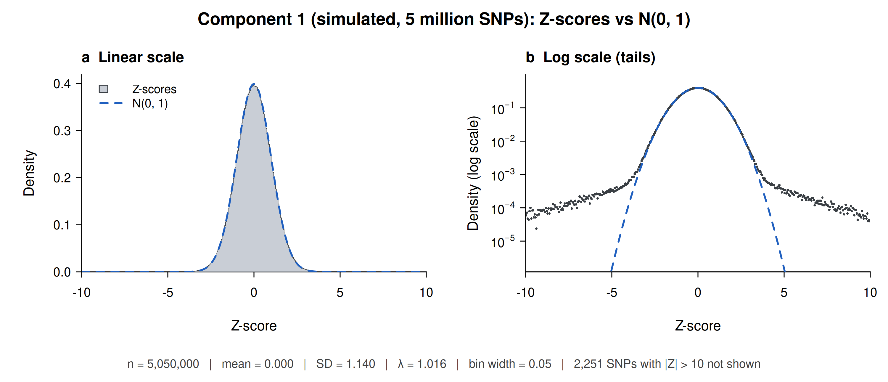

# GenRomica: genetic ICA component scores and child outcomes in Generation R

This pipeline tests whether genetic scores are associated with child
outcomes in the Generation R Study (GenR). The scores are ICA components of
genome-wide SNP effects, derived in an independent study, plus other polygenic
scores. Outcomes are behaviour (CBCL), brain imaging (MRI, DTI), SES, diet and
online activity.

It is a restructured version of the original analysis code
(`Code_Hailey_Components.docx`). **The statistical logic is unchanged, with one
deliberate exception:** all mixed-model tests now use the same Satterthwaite
F-test (see [Change from the original](#change-from-the-original)). Apart from
that, on simulated data the new code reproduces the original code's output
exactly (see [Verification](#verification)). Concerns about the code and the science are
listed in [Concerns](#concerns); none of them has been acted on yet.

## Pipeline

| Step | Script | Input | Output |
|---|---|---|---|
| 1 | `R/01_export_genr_data.R` | GenR RDS file | one `csv.gz` per data type (run once) |
| 2 | `R/02_merge_components.R` | variant catalogue, ICA Z-scores | `component<i>.txt`, Z-score QC plots |
| – | *(not in this pipeline)* | `component<i>.txt` | `component<i>_corrected.txt` (see concern A1) |
| 3 | `R/03_clean_components.R` | `component<i>_corrected.txt` | `component_<i>_QC.txt` |
| 4 | `R/04_compute_scores.R` | GenR genotypes (bigSNP), QC'd weights | subject-level scores `csv.gz` |
| 5 | `R/05_run_regressions.R` | step 1 + step 4 output | results tables |

Every step takes a config file, and is run from this folder:

```bash
Rscript R/05_run_regressions.R config/project.R
```

- `config/project.R` holds all paths and analysis settings: waves, outcomes,
  score sets and reference age. The paths are the original ones; edit them for
  your machine.
- `config/toy.R` points the same settings at simulated data.
- `R/utils.R` holds the shared helpers.

Required R packages: `data.table`, `R.utils` (reads `.gz`), `lme4`, `lmerTest`,
`performance`, `bigsnpr`, `dplyr` (used by `bigsnpr::snp_match` for strand flips).

### Data conventions

- **Effect allele.** In the variant catalogue and all summary statistics, `A2`
  is the effect allele: the sign of the Z-score refers to `A2`. `A1` is the
  other allele.
- **`BETA` holds Z-scores.** The ICA component files already contain Z-scores.
  The column is called `BETA` only so that standard tools recognise it.
- **P is computed from Z.** Only the Z-score files are read. Step 2 computes
  two-sided p-values as `P = 2·Φ(−|Z|)`. Old `p_val_component<i>.txt` files are
  not used; the toy data writes them only for the original code in `reference/`.
- **Positional matching.** The ICA Z-score files have no SNP identifier.
  Row *k* belongs to the *k*-th SNP of the variant catalogue with
  `include == 1`. Step 2 stops if the row counts differ.
- **Z-score QC plots.** For each component, step 2 writes
  `component<i>_z_histogram.png` to `cfg$qc_plot_dir`. It shows the Z-score
  histogram against a dashed N(0, 1) density, on a linear scale and on a log
  scale (for the tails). It also writes `component_z_summary.csv` with n, mean,
  SD, λ (median Z² / 0.455) and the count of |Z| > 5.45 per component.
  - Bins have a fixed width of 0.05 (`cfg$z_hist_binwidth`), because a rule
    that scales with n would create very many tiny bins for millions of SNPs.
    At this width, a bin near zero holds about 20,000 SNPs per million, so the
    histogram is smooth and any gap with the dashed curve is real.
  - The x-axis covers the 99.99th percentile of |Z|, kept between 5 and 10;
    SNPs beyond it are counted below the plot.
  - 5 million SNPs take under a second.

  

  - ICA looks for maximally *non*-Gaussian components, so heavy tails are
    expected; they are the signal. The plot is for spotting problems such as
    a shifted mean, a wrong scale, or truncation.
- **GenR data.** Only GenR variables are exported in step 1. Genetic scores
  are never read from the RDS. They are computed from the genotypes in step 4,
  because their weights come from another study.

### Checks that stop the pipeline

Every step checks its inputs and stops with a message saying what is wrong and
which R commands to run to investigate. It stops when:

- an input file is missing;
- a required column is missing (the message gives `grep()` commands to find similarly named columns);
- `idc` values are duplicated;
- the row counts of the variant catalogue and the component files differ;
- a variable that enters a model as a number is a factor or text;
- a column shared by two GenR files holds different values.

In the original code, a measure missing at a wave was skipped silently. Here
every `<measure>_<wave>` listed in `cfg$longitudinal` must exist. If a measure
was not collected at a wave, remove that row from the config (there is an
example there). For example, CBCL/1½-5 at wave f05 has no rule-breaking scale.
This gives the same results as the original code, but the omission is now explicit.

### Answers to review questions

**Is the cleaning done in place?** No, in both versions. Each file is read from
an input folder and a cleaned copy is written to a separate output folder; the
input files are never changed. In memory, `df <- df[...]` creates a filtered
copy. The `:=` assignments change the freshly read table in place, which has
no effect outside the script.

**Why not use `bigsnpr::snp_match`?** It is now used in step 4, where it matters
most. `snp_match` aligns the weights with the genotype data:

- it joins on chromosome and position;
- it flips the sign of a weight when the genotype data count the other allele;
- it matches alleles reported on the opposite strand;
- it removes duplicates.

Without it, any SNP whose counted allele differs from the effect allele would
enter the score with the wrong sign.

`snp_match` does not replace the QC in step 3, which also removes non-finite
Z-scores, p-values outside (0, 1], non-autosomal SNPs and non-ACGT alleles.
Palindromic SNPs are still removed in step 3 to replicate the original.

Strand flipping follows the usual procedure. Matching first runs with
`strand_flip = TRUE`. If fewer than `cfg$min_strand_flips` SNPs (default 10)
needed a strand flip, it reruns with `strand_flip = FALSE`, which keeps
strand-ambiguous SNPs. Because step 3 already removes palindromic SNPs, the
rerun can currently only drop those few flipped SNPs; see concern B2. The
choice for each score is logged in `*_snp_matching.csv`.

## The statistical models

The comments in `R/05_run_regressions.R` describe the same models next to the
code.

**Terminology.** Subject-level scores built from the ICA component weights are
called **GPS (GenomICA Polygenic Scores)**. For SNP $`k`$, let $`Z_k`$ be its
component Z-score and $`G_{ik} \in [0, 2]`$ the number of effect alleles child
$`i`$ carries. The GPS of child $`i`$ is

```math
\mathrm{GPS}_i = \sum_{k} G_{ik}\, Z_k .
```

It is computed in step 4. Score sets `C` and `UK_PCS` are GPS; set `PGS` holds
conventional polygenic scores. All are analysed in the same way.

### 1. Repeated measures, one score at a time

Linear mixed model, fitted by maximum likelihood. For measurement $`j`$
(wave f05, f09, f13 or f17) of child $`i`$:

```math
\begin{aligned}
\mathcal{M}_0:\quad y_{ij} &= \beta_0 + \beta_1 a_{ij} + \beta_2 a_{ij}^2 + \boldsymbol{\gamma}^{\top}\mathbf{x}_i + u_i + \varepsilon_{ij}\\[4pt]
\mathcal{M}_1:\quad y_{ij} &= \beta_0 + \beta_1 a_{ij} + \beta_2 a_{ij}^2 + \beta_3 S_i + \boldsymbol{\gamma}^{\top}\mathbf{x}_i + u_i + \varepsilon_{ij}\\[4pt]
\mathcal{M}_2:\quad y_{ij} &= \beta_0 + \beta_1 a_{ij} + \beta_2 a_{ij}^2 + \beta_3 S_i + \beta_4 S_i a_{ij} + \beta_5 S_i a_{ij}^2 + \boldsymbol{\gamma}^{\top}\mathbf{x}_i + u_i + \varepsilon_{ij}
\end{aligned}
```

```math
u_i \sim \mathcal{N}(0, \sigma_u^2), \qquad \varepsilon_{ij} \sim \mathcal{N}(0, \sigma_\varepsilon^2), \qquad u_i \perp \varepsilon_{ij}
```

| Symbol | Meaning |
|---|---|
| $`y_{ij}`$ | **Outcome** of child $`i`$ at wave $`j`$. Examples: the CBCL anxious/depressed sum score (`sum_anx_<wave>`), total grey-matter volume (`TotalGrayVol_<wave>`), mean fractional anisotropy (`mean_FA_genr_<wave>`). It is z-transformed once, over all observations in the model's analysis sample, so across children *and* waves together. |
| $`a_{ij}`$ | **Age** at that measurement minus 17 years. $`a_{ij}^2`$ is its square; together they give a quadratic developmental trajectory centred at age 17. |
| $`S_i`$ | **Score** of child $`i`$ (a GPS or PGS). It is constant over waves and z-transformed across children: the mean and SD are taken over individuals, each counted once however many measurements they have. |
| $`\mathbf{x}_i`$ | **Covariates:** sex, genotyping cohort (genotyping batch/array) and gPC1–4. The gPCs are the first four principal components of the genome-wide genotypes, which capture genetic ancestry; they are z-transformed across children. A covariate that is constant in the analysis sample is dropped. |
| $`u_i`$ | **Random intercept** of child $`i`$: how far that child's average outcome level lies from the population intercept $`\beta_0`$, the same at every wave. It models the correlation between repeated measurements of the same child. |
| $`\varepsilon_{ij}`$ | Residual error of measurement $`j`$ of child $`i`$. |

**Why these terms.**
- **Fixed effects:**
  - $`\beta_1, \beta_2`$ describe the average outcome trajectory with age.
  - $`\boldsymbol{\gamma}`$ adjusts for sex differences, genotyping batch effects and population stratification (ancestry differences correlated with both score and outcome).
  - $`\beta_3`$ is the score association.
  - $`\beta_4, \beta_5`$ let that association change with age.
- **Random effects:** only $`u_i`$. There are no random slopes, so all children share one trajectory shape apart from the score terms. There is no family-level effect (see concern C5).
- **Maximum likelihood** is used rather than REML, so that models with different fixed effects can be compared.

**Hypotheses** (all tested with `lmerTest::contestMD`, Satterthwaite denominator df):

```math
\textbf{H1:}\;\; \beta_3 = 0 \;\text{ in } \mathcal{M}_1
\qquad\qquad
\textbf{H2:}\;\; \beta_4 = \beta_5 = 0 \;\text{ in } \mathcal{M}_2
```

- **H1** is a 1-df *F*-test; its p-value equals that of the Satterthwaite *t*-test. Because $`\mathcal{M}_1`$ has no interaction terms, $`\beta_3`$ is the association averaged over ages, in SD of outcome per SD of score.
- **H2** is a 2-df *F*-test of whether the association changes with age. In $`\mathcal{M}_2`$, $`\beta_3`$ is the association at age 17.
- **Effect size:** the incremental Nakagawa marginal $`R^2`$ (variance explained by fixed effects): $`R^2_{\mathcal{M}_1} - R^2_{\mathcal{M}_0}`$ for H1 and $`R^2_{\mathcal{M}_2} - R^2_{\mathcal{M}_1}`$ for H2.

### 2. Repeated measures, a whole score set jointly

All $`K`$ scores of a set (e.g. the 20 component GPS) enter one model, each
z-transformed across children:

```math
y_{ij} = \beta_0 + \beta_1 a_{ij} + \beta_2 a_{ij}^2 + \sum_{k=1}^{K} \theta_k S_{ik} + \boldsymbol{\gamma}^{\top}\mathbf{x}_i + u_i + \varepsilon_{ij}
```

```math
\textbf{H1:}\;\; \theta_1 = \theta_2 = \dots = \theta_K = 0 \qquad (K\text{-df } F\text{-test, Satterthwaite})
```

### 3. Outcomes measured once (ordinary least squares)

For SES, diet and online use (one row per child):

```math
y_i = \beta_0 + \sum_{k} \theta_k S_{ik} + \boldsymbol{\gamma}^{\top}\mathbf{x}_i \;[+\, \delta\, \mathrm{age}_i] + \varepsilon_i,
\qquad \varepsilon_i \sim \mathcal{N}(0, \sigma^2)
```

- The sum has either one score or a whole set.
- $`\mathrm{age}_i`$ (age at measurement) is included only for outcomes that have one, e.g. `AgeChild_GR1203` for online use.
- H1 ($`\boldsymbol{\theta} = \mathbf{0}`$) is the exact nested-model *F*-test. For a single score, the reported estimate is $`\theta_1`$.

### Multiple testing

Benjamini–Hochberg FDR, applied separately within each score set × hypothesis.

### Change from the original

The original code used three different tests for the mixed models:

- a Satterthwaite *t*-test for single-score H1;
- a Satterthwaite *F*-test (`contestMD`) for H2;
- a likelihood-ratio χ² test, `anova(m0, m1)`, for H1 of the combined score sets.

All three now use `contestMD` through one helper, `joint_f_test()`. This
changes only the combined-set p-values, and the FDR values within those sets.
For single-score H1, the 1-df *F*-test gives the same p-value as the *t*-test.

To reproduce the original results, uncomment one line in `fit_lmm_score_set()`
in `R/05_run_regressions.R`:

```r
# h1_p <- anova(m0, m1)[2, "Pr(>Chisq)"]
```

With that line uncommented, the toy run matches the original exactly. A
commented line also restores the old single-score *t*-test p-value, which is
numerically identical.

## Verification

```bash
bash toy/run_toy.sh
```

This takes about one minute on a laptop. It does three things:

1. It simulates toy data (`toy/make_toy_data.R`): 500 GenR children, 480
   genotyped children and 3,000 SNPs. The data include SNPs that QC must remove,
   SNPs with swapped alleles or reported on the opposite strand, missing
   genotype calls, the `sum_wid_f05` naming quirk, stale score columns in the
   RDS, and a non-alphabetical factor reference level.
2. It runs steps 1-5 with `config/toy.R`.
3. It runs `toy/compare_with_original.R`, which:
   - runs the original code, transcribed in `reference/` with only the paths
     changed, and checks that the merged and cleaned files are identical;
   - recomputes one score by hand and checks it against bigsnpr;
   - runs the original regression code and checks that every result table
     matches the new code to 1e-10. The exception is the combined-set
     mixed-model p-values (and FDR values), which changed deliberately. For
     those, it reports how the new F-test and the old likelihood-ratio
     p-values compare. On the toy data the correlation of −log10 p is 1.000.

All checks pass.

**Reference transcription.** In `reference/original_regression.R`, two parts
could not be read from the screenshots and had to be assumed (marked `# EDIT`):

- line 134, the body of `scale_gpcs`, assumed to be `z_by_id` per gPC;
- everything after line 476 (the end of the FDR merge and writing the output).

The assumption about line 134 only affects the gPC rows of
`covariate_results.csv`. Rescaling a covariate does not change any other
estimate, p-value or R². Check both parts against the real script.

**Precision.** Step 1 writes decimal numbers with 17 significant digits.
`fwrite`'s default of 15 digits changed the Nakagawa R² at the 1e-6 level.

## Concerns

These are recorded for discussion and have **not** been acted on, so that
the original results can be replicated first.

### A. Pipeline and data handling

1. **Unknown "corrected" step.** The QC script reads `component<i>_corrected.txt`,
   but step 2 writes `component<i>.txt`. The correction in between is not part of
   the code we received, so this pipeline cannot rerun it. It should be added
   or documented.
2. **Positional matching of ICA output.** Row order is checked only through the
   row count. If the ICA software kept SNP identifiers, joining on them would be safer.
3. **Meaning of the catalogue's 7th column (`include`).** It is undocumented.
4. **Genotype IDs.** Step 4 assumes the `.fam` `sample.ID` equals GenR `idc`
   (`cfg$genotype_id_column`). If it does not, a linking file is needed.
5. **Genome build.** `snp_match` joins on position, so the ICA study and the
   GenR genotypes must use the same build (GRCh37 vs GRCh38). This is not checked.
   `snp_match` errors when fewer than 20% of SNPs match, which catches gross
   mismatches only.
6. **Imputed dosages vs hard calls.** Step 4 mean-imputes missing calls
   (`mean2`, rounded to 2 decimals). If the scores in the original RDS were made
   differently (imputed dosages, other software), they will not match exactly.
   Compare step-4 scores with the RDS scores once before replacing them.
7. **UK_PCS and PGS sources.** It is unknown which summary statistics produced
   `UK_PCS_*` and `PGS_*`. Add them to `cfg$score_weights`, or list a file of
   precomputed scores in `cfg$score_files`.
8. **Duplicated `idc`.** The original code would silently use the first row
   (`match()`); the pipeline now stops.
9. **Warnings were invisible.** The original code captured errors but not
   warnings, such as non-convergence. They are now logged in
   `model_warnings.csv` without changing any result. Singular fits are flagged
   in `results.csv` (`singular`), but their p-values are still reported.
10. **Silent skips.** A model with too little variation returns no row and is
    not logged in `failed_models.csv`. Compare the number of result rows with
    the number expected.

### B. Summary statistics and scores

1. **p = 0 is removed.** QC keeps `P > 0`. Because P is computed from Z, P is
   0 only when |Z| > ~37.5 (double-precision underflow). Those SNPs are the
   strongest signals and are dropped. Consider a filter on Z instead of P.
2. **Palindromic SNPs are removed by default.** This costs roughly 15% of SNPs.
   With well-defined strands (same reference panel), `snp_match(strand_flip = FALSE)`
   could keep them. The strand-flip switch in step 4 only helps if they are not
   already removed in step 3.
3. **Lowercase alleles are dropped** rather than upper-cased.
4. **Score construction.** The score is Σ dosage × Z over all SNPs, with no LD
   clumping or shrinkage. Correlated SNPs therefore count several times, and
   Z-scores scale with the discovery study's sample size. That is fine for an
   ICA-component projection, but the score is not an optimised PGS.
5. **Ancestry.** GenR is multi-ethnic. If the ICA study used European-ancestry
   data, score performance will differ by ancestry. Four gPCs may not fully
   control stratification; consider restricting to, or stratifying by,
   genetic ancestry.

### C. Statistical models

1. **Age centred at 17, the oldest wave.** `age_c` and `age_c²` are then highly
   correlated, and in M2 the score main effect is the effect at age 17. In M1
   (H1) centring does not change b3, but centring at the mean age, or using
   orthogonal polynomials, would make M2 more stable and easier to interpret.
2. **Different CBCL instruments.** Wave f05 used the CBCL/1½-5, and later waves
   used the CBCL/6-18. The scales differ in items and range, but are pooled and
   z-scored together. Standardising within wave, or modelling the instrument,
   would be more defensible.
3. **Outcome standardisation is pooled over waves.** It does not change the
   p-values, but estimates are in pooled-SD units.
4. **Skewed outcomes.** CBCL sums are counts with many zeros, and the models
   assume normal residuals. Consider a transform, or a count model, for robustness.
5. **Siblings and twins.** GenR includes related children. The random intercept
   is per child only, so related children are treated as independent. Keep one
   child per family or add a family random effect.
6. **ML vs REML.** Models are fitted with ML, which is needed for the
   likelihood-ratio test. Satterthwaite tests of fixed effects are usually done
   on REML fits; the differences are small at GenR sample sizes.
7. **Different tests for mixed and OLS models.** All mixed-model tests now use
   a Satterthwaite *F*-test (see [Change from the original](#change-from-the-original)).
   The single-time OLS models use the exact nested-model *F*-test. Both are
   *F*-tests, but the mixed-model denominator df is approximated.
8. **Constant covariates are dropped silently.** If a covariate is constant
   (e.g. one genotyping cohort in a subsample), models for different outcomes
   use different covariate sets.
9. **Complete-case samples differ** between outcomes and scores, so `n_id` varies.
10. **FDR grouping.** Within each score set, longitudinal and single-time outcomes
    share one FDR family, while the jointly tested sets are separate families.
    This is defensible, but should be pre-specified. Whether to correct across
    score sets as well should be decided too.
11. **Incremental R².** Nakagawa R² is NA for singular fits, and differences
    can be negative. For OLS, the raw (not adjusted) R² difference is reported.
12. **SES outcomes are parental.** Maternal and paternal education and household
    income are parent characteristics. An association with the child's score
    reflects shared parental genetics (genetic nurture, or confounding),
    not an effect on the child.
13. **Ordinal outcomes treated as continuous** (`INCOME5`, `EDUCM`, `EDUCP`).
    Step 1 stops if they are stored as factors, so their coding has to be
    chosen explicitly.
14. **Timing.** `DietScore_8y` is measured at about age 8 and the online measure
    at about 17. Single-time outcomes are adjusted for age only where an age
    variable is given.
